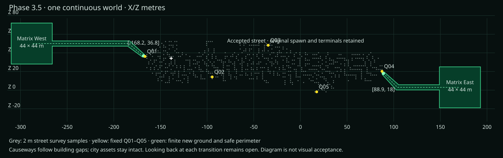

# Phase 3.5 — Matrix digital world extension

## Scope and acceptance gate

Started `feature/phase-3-5-matrix-extension` from latest merged `main`,
**`39ee045893c8c3b456894fc0e1097ac942dcd912`** (PR #5). The instructor
accepted Phase 3 on Windows 11. Its earlier submission checklist is historical;
this phase needs separate Windows 11 Chrome/Edge acceptance. The repository
remains **Private**. No upstream repository, public asset, teacher tool or course
publication was changed. Deliver a Draft PR and stop before Phase 4, merging,
release or deployment.

## Multilingual text revision of Draft PR #6

The instructor requested actual readable Unicode text in place of the initial
5 × 7 pseudo-symbol bitmap. This revision updates the **same Draft PR #6** on
`feature/phase-3-5-matrix-extension`; no additional PR, merge or phase is started.
Zone positions/dimensions, openings, surfaces/boundaries, education, terminals,
controls and original post/render architecture remain unchanged from `9fb86e1`.

The curated inventory has **96 actual characters**: 26 A–Z letters, 10 digits
plus six symbols (`+-=<>*`), 25 Katakana plus 15 Hiragana, and 14 precomposed
Hangul syllables. Inventory, category membership, cells and selection are pure
JavaScript in `glyphInventory.js`, independent of browser APIs. There are no
randomly constructed strokes, pseudo-writing or question-mark substitutions.

Each 20-slot column contains exactly **5 English, 4 number/symbol, 6 Japanese,
5 Korean** entries (25/20/30/25%). A seeded shuffle puts one of each category in
the first four positions, so even the shortest eight-slot trail mixes all four.
Character choices within each category are sampled without replacement for each
column. Both zones use this mixture, with distinct stable sequences per column;
no identity changes during animation. Across visible trail lengths, the measured
mixture is **25.01% / 20.29% / 29.40% / 25.29%** respectively.

### Font choice and portable coverage

The local **9,964-byte** WOFF2 subset is renamed **Lab Matrix Text Regular**,
derived from **Noto Sans CJK JP Regular 2.004**, copyright © 2014–2021 Adobe,
under **SIL OFL 1.1**. Its cmap contains a distinct real glyph for every inventory
character, including Japanese and Korean; coverage is inspected from the bundled
binary with fontTools, rather than inferred from a font name. No system-font
coverage or external CDN is required. The font remains under OFL, separate from
the application's MIT code. Original glyph outlines are preserved.

Source commit `f8d157532fbfaeda587e826d4cd5b21a49186f7c` from `notofonts/noto-cjk`,
`Sans/OTF/Japanese/NotoSansCJKjp-Regular.otf`, is pinned by SHA-256. The full OFL,
source/derivative hashes, attribution, modifications and reproduction steps are
in `public/licenses/matrix-text/{OFL.txt,NOTICE.txt}`. The build carries those
notices and emits the subset as a local hashed font asset. The full 16 MB source
font is **not bundled**. `scripts/subset-matrix-font.py` reproduces the subset
using optional build-time fontTools 4.61.1 / Brotli 1.2.0 and pinned Node; no npm
runtime dependency or lockfile change is introduced. The independent cmap
inventory is test-only in `tests/fixtures/matrix-font-coverage.json`.

Initialization awaits one cached `FontFace.load()` before atlas rasterization;
load failure rejects before changing scene/colliders, rather than drawing a
system fallback. The asynchronous factory requires only an `await` in the world
and test-harness callers. No loading UI, gameplay mode or extra loop is added.

The shared transparent Canvas atlas is **768 × 768 RGBA**, a **12 × 8** grid of
**64 × 96** cells. Text uses actual font ink bounds at up to 56 px, scales down
when necessary, and centers that ink consistently with at least six pixels of
padding. This cell aspect preserves the existing 0.3 × 0.46 m billboard geometry
and recognizable font proportions. Linear filtering, transparent padding, no
mipmaps, explicit cell indexing and a within-cell Y flip prevent bleeding,
clipping or upside-down mappings. The atlas is rasterized once per world
initialization and never redrawn/reuploaded by the frame update. Both zone draws
sample it; falling positions, speed/length data, green head/tail colors,
brightness, fade formulas, culling and 10,240-slot cap are unchanged.

## Original boundary analysis and chosen passages

Inspected the actual decoded `cyberpunk_compressed.glb`, `colider.glb`, original
transforms/BVHs/material sidedness, `loadCity`, `createWorld`, `createGround`,
`createWalkControls`, and the Phase 3 survey. No GLB is edited or overwritten.
The accepted standing region spans about 256 m in X and 54 m in Z; this is a
connected survey, not the boundary of every visible city mesh.

The main street is longitudinal along **X**, but its practical exits turn
**northwest (−X/+Z)** and **southeast (+X/−Z)**. Straight extensions along X would
run into real buildings. Original city geometry at chest height forms diagonal
building fronts (`Cube018_1` and related props), with small intervening gaps.
The invisible collider closes those gaps using local box-like obstacles. It is
one mesh with **156 triangles**, not a single enclosing rectangular box. Its
world AABB is approximately X [−174.163, 101.676], Z [−109.361, 166.632].

For example, from [−164, −4.3925, 34] along northwest at 45°, the original bounds
hit is about 5.0 m away at [−167.5, −4.3925, 37.5]; the first actual city hit is
about 37.6 m away. From [86, −4.3925, 21] along southeast at 45°, the bounds
hit is about 4.2 m away at [88.9, −4.3925, 18.1], while the city hit is about
41.9 m away. Thus localized openings can use existing gaps without removing a
building. A naïve straight-X opening cannot.

| Zone | Entrance center `[x, z]` | Runtime opening world min / max `[x,y,z]` | Exterior plaza |
| --- | --- | --- | --- |
| West | `[-168.2, 36.8]` | `[-171,-6,34.8]` / `[-165.8,-1.6,40]` | center `[-288,50]`, **44 × 44 m**; X [−310,−266], Z [28,72] |
| East | `[88.9, 18]` | `[86.8,-6,14.6]` / `[91,-1.6,21]` | center `[171,3]`, **44 × 44 m**; X [149,193], Z [−19,25] |

The original city AABB extends roughly X [−264.867, 146.744]. Narrow causeways
pass between its existing outlying buildings before opening into the plazas
beyond that X extent. West turns through [−184,50], then runs west along Z=50;
east turns through [104,3], then runs east along Z=3. Neck width starts around
3.4 m and widens to a 5.6 m causeway. Exact ground/perimeter vertices are in
`matrixLayout.js`; the closing edge is the entrance, with no new barrier.

The west causeway is longer because buildings prevent a wide plaza immediately
at that gate. Entrance-to-plaza-edge distances along the centerline are about
**102.6 m west** and **66.3 m east** (about 23 s / 15 s at normal walking speed).
Digital ground/rain starts at each entrance; players enter the new atmosphere
before reaching its open plaza. This keeps all existing buildings and limits
new construction to two small plazas and simple connecting surfaces. It is a
finite extension, with no new city, loading screen, teleport or mode switch.



Grey points are samples of the accepted street, not a model outline. +Z is up;
west/east describe world −X/+X, not geographic directions. The original spawn
`[-138.564,-3.95,34.181]` and all five terminal positions are unchanged. Routes
pass around Q01/Q04 casings; neither terminal is relocated or obstructed.

## Ground and collision strategy

The unchanged wet-ground plane is **400 × 400 m**, centered on the origin at
Y=−5.4, so it reaches both transitions. Its reflection resolution, textures,
material, rain ripples and update behavior remain unchanged. New lightweight
shape surfaces occupy only each exterior footprint. They sit 2 mm higher at
**Y=−5.398** to avoid coplanar fighting and blend from transparent to dark digital
ground over 12 m outward from each gate. They add no reflection target or pass.
The 2 mm step is below existing step tolerance; real-controller tests retain the
standing eye within 2 cm of its accepted height, including original-ground ends.

`openCityBounds` partitions original triangles against the six planes of the two
explicit boxes and discards only their interior portions. It does not drop whole
intersecting triangles, disable a collider, change material sidedness, or alter
city/vehicle geometry. It clips in world space then returns vertices to the
original mesh's local coordinates and rebuilds only the replacement bounds BVH.
The runtime replacement has 292 triangles after clipping; all bounds
above/below/outside the local boxes remain. Original geometry is kept
for restoration on disposal. Nearby city buildings remain physical obstacles.

Every exterior outline edge except its city entrance has an invisible 8 m-high
wall with overlapping ends and the existing BVH wall-ray collision path. The
plaza's outer edge is obscured by dark local backdrop panels, fading grid and
falling glyphs. There is no unbounded plane or unrestricted exterior movement.
No outer path relies on the original ground extending forever: the west zone
passes beyond X=−200 and is supported by the new surface.

A `WalkGround` group contains the original wet plane and both new surfaces.
The camera director changes only the ground argument to recursively probe that
group; it falls back to the original ground for callers without extensions.
The original walking controller, acceleration/deceleration, 4.5/9 m/s speeds,
sprint ramping, collision/ground algorithms and camera fixes are unchanged.

## Architecture and digital effect

- `createMatrixExtension` composes two zones, their ground, perimeter collisions,
  local atmosphere, clock, culling and disposal. `createWorld` registers the new
  collider and the combined ground-probe group. The existing render loop calls
  `matrix.update(delta,camera)` once; there is no second animation loop.
- The **768 × 768 shared Canvas atlas** contains the 96 curated Unicode entries
  described above, rendered from a licensed local font subset. No movie texture
  or random stroke generator is used.
- **256 columns × 20 glyph slots per zone**, capped at **10,240 instances total**.
  Each zone is one instanced billboard draw. Columns vary in phase, speed
  (1.8–5.2 m/s), trail length (8–20) and depth. Brighter pale-green heads fade
  to dark green tails. Fixed glyph identities avoid frame-by-frame flicker.
  Vertex TSL computes continuous falling/wrapping positions; no CPU per-glyph
  integration, DOM animation, compute texture, dependency or fullscreen pass.
- 192 columns occupy each plaza with dark gaps; 64 follow its causeway.
  Glyph opacity ramps outward over 16 m and fades with camera distance from
  24 to 64 m. Each atmosphere group is CPU-culled beyond 64 m from its route/
  plaza. Ground uses a restrained moving grid pulse, distance fade and perimeter fade
  that hides luminous lines near outer edges while retaining the causeway opening.
- Three dark panels surround the far/sides of each plaza; the city-facing side
  is open. These are local meshes. There are **no writes to shared scene fog,
  background, lighting, environment, rain, grading, bloom or post parameters**.
  Looking back from either transition has no added opaque backdrop in the way.
- Nonphysical glyph/backdrop groups join the existing rain-height hide list;
  exterior ground stays in that pass. Digital characters never become false
  roofs for the original rain. No original effect is disabled or reduced.
- The atlas and perimeter geometry/material are shared. Instance attributes use
  about **280 KiB total**. The atlas is now **2.25 MiB RGBA** instead of the initial
  24 KiB bitmap, with a retained 2.25 MiB Canvas backing store plus driver
  overhead. This is one shared upload, with no mipmaps/per-frame rasterization.
  The only new downloaded font payload is **9,964 bytes**, served locally; the
  font notices also ship with the build. Original public asset bytes are unchanged. Maximum added scene draw budget is two grounds, two rain
  meshes and six backdrop panels (10 before culling). The separated gates allow
  atmosphere culling to keep the distant zone inactive. These are resource
  limits, **not measured FPS**; transparency/fill cost still needs hardware review.
- Idempotent `dispose()` removes reparented ground as well as the effects/collider,
  unregisters its collider, disposes generated geometry/BVHs/materials/atlas, and
  restores original bounds.
  Development HMR registers it through the world factory; callers can explicitly
  invoke `world.matrix.dispose()`. Page teardown releases the remaining app as
  before. No renderer-wide teardown rewrite is introduced.

The accepted educational modules are byte-identical: fixed Q01–Q05, yellow/green
indicators, radius/X, four/five units, Demo, allowlisting/v1/v2, teacher exports,
answers, native video/explanation/Form links, in-memory progress, modal isolation
and trusted Close & Resume. No new terminals or course materials are added.

## Automated evidence

Pinned **Node 22.23.4 / npm 10.9.9**. Before implementation, clean `npm ci`,
**498/498** Node tests, build (201 modules), **5/5** Python tests and all three
Phase 1–3 browser suites passed. The initial Phase 3.5 submission also ran a
clean install and 502 tests. This Unicode revision leaves package declarations/
lockfile unchanged and reruns Node/build/Python and all browser suites; the table
below records current results (the install row is the original unchanged-dependency
validation).

| Check | Result |
| --- | --- |
| `npm ci` | Initial Phase 3.5 clean install passed, 331 packages; no package/lockfile change in this revision |
| `npm test` | **505/505 passed**, including all 498 pre-Matrix tests, retained collision/budget tests, and Unicode inventory/distribution/UV/font-coverage tests |
| `npm run build` | Passed, **207 modules**, static production output |
| `python -m unittest tests.test_assignment_contract -v` | **5/5 passed**; 364 validation cases and 76 answer selections retain JS/Python/schema parity |
| Phase 1 browser suite | Passed with extension enabled: five continuous spawn walks and ten pair walks, all terminal clearance/interaction checks, actual car blocking, Pointer Lock/filter/R/P, 13 quiz cycles, focus/modal/orbit regressions |
| Phase 2 browser suite | Passed: v1/v2, four/five questions/Q05, safe text, allowlist/switch/cancel/stale/error behavior, position preservation, Demo/reload/session-only state |
| Phase 3 browser suite | Passed: trusted mouse/keyboard resume and refusal/focus safety; 8 intercepted native provider actions; explanation, 4/4–5/5 Forms, stale-link cleanup, retained progress and green indicators |
| Phase 3.5 browser/controller suite | Passed: continuous outward/exploration/return routes, **20,214** supported movement samples, **18** exterior edges at walk/sprint plus 8 plaza corners, **8,458** retained original boundary surface samples, nearby building blocking, look-back geometry, culling/height-pass isolation, **20** generated resources disposed and bounds restored |
| Multilingual browser rasterization | Passed: 96 unique nonempty real glyph rasters; exact independent cell comparisons, safe padding/centering and replacement-glyph rejection; one local font request; correct GPU indices; stable atlas/attributes over 600 updates; blocked-font initialization rejects cleanly |
| Verified HTTPS dev 5173 / preview 4176 | Passed: document, two entry resources and all **54 original public asset hashes** on each |
| Protected-source/output/whitespace audit | Passed: original public files, controls, education, city loader/GLBs, wet ground, original shaders/post/platform, schemas/tools, packages/license/credits unchanged; empty production manifest only, no fixture/coursework/survey/docs/tools/schema output |
| Full-app software WebGPU diagnostic | **Known failure reproduced**: WebGPU device loss and dark canvas. Secure context, adapter, ENTER, HUD, five terminals and extension creation are startup evidence only |
| New physical Windows 11 acceptance | **Pending; not performed in Codex**, including multilingual glyph/readability checks in Chrome and Edge |

Measured continuous routes from the **original spawn**, including accepted city
walking segments: west out **159.97 m**, plaza exploration **159.52 m**, return
**160.04 m**; east out **332.94 m**, exploration **159.52 m**, return **332.86 m**.
Routes use ordinary controller input at 60 Hz; no position resets occur between
waypoints. Independent route/boundary tests initialize their own starting states.
Each movement sample checks real down-ray support and eye height, rather than
assuming the controller will fall when support is missing. Speed/step bounds
reject unexpected jumps. All previous terminal-route distances remain unchanged.

The bounds audit samples every original source triangle on a barycentric grid
and checks that ray hits survive outside the two explicit opening boxes. It is
strong sampling evidence, not a mathematical proof about every point/asset update.
Actual city rays and visibility flags confirm look-back geometry is present and
uncovered at the transitions; **they do not prove rendered visibility** through
real fog/post effects. Phase 3's material-sidedness correction remains intact.

The separate full-app WebGPU probe reports `A valid external Instance reference
no longer exists`, `WebGPU Device Lost`, and `Instance dropped in popErrorScope`,
exiting **2**. This cloud has no hardware `/dev/dri` GPU. An additional isolated
Matrix-only software **WebGL fallback diagnostic** exercised the same TSL graph
and showed the generated ground/glyph layout without page/console errors; it is
a separate development scene, not a production fallback or a full-app acceptance
test. An isolated WebGPU attempt also reproduced the cloud instance error.
Neither diagnostic establishes Windows WebGPU correctness, original-city visual
parity, browser compatibility or performance. No original feature was disabled in
the production app. Existing large-bundle and transitive `tar@7.5.7` warnings remain.

All fixture provider requests are intercepted before navigation. No real course
content, identity/answer collection, tracking or new persistent storage is used.
Metrics are test-only in `tests/fixtures/matrix-route-metrics.json`. The revised
Unicode browser suite writes `/tmp/matrix-text.json` and `/tmp/matrix-text-atlas.png`.
Linux Chromium Canvas output has no observed tofu/substitution, and bundled cmap
coverage avoids relying on OS fonts. **Supported Windows browsers have not been
physically checked here**; their final WebGPU raster/sampling/readability and
no-tofu acceptance remain on the checklist. An isolated software WebGL TSL
render checks the revised atlas orientation/style separately from full-app
WebGPU acceptance. The original cloud device-loss limitation remains.

## Reproduce

Activate the pinned Node runtime in each shell, then:

```bash
npm ci
npm test
npm run build
python -m unittest tests.test_assignment_contract -v
BROWSER=none npm run dev -- --host 127.0.0.1 --port 5173 --strictPort
```

Export the running Vite server's public certificate using the Phase 0 instructions.
Restart it after `npm ci`; do not reuse a stale certificate or disable verification.
In another shell:

```bash
python scripts/browser-phase-1.py --cafile <public-certificate>
python scripts/browser-phase-2.py --cafile <public-certificate>
python scripts/browser-phase-3.py --cafile <public-certificate>
python scripts/browser-phase-3-5.py --cafile <public-certificate>
python scripts/browser-matrix-text.py --cafile <public-certificate>
python scripts/verify-baseline.py --origin https://127.0.0.1:5173 --cafile <public-certificate>
python scripts/plot-matrix-layout.py
```

The new browser suite writes `/tmp/phase-3-5-metrics.json`. The diagram generator
uses only Python's standard library plus the pinned Node executable on PATH and
reads runtime layout/accepted test survey; it adds no dependency. A harness-only
`?originalBounds` option omits the extension for source-boundary investigation.
The production app has no scene/mode switch.

Optional full-app diagnostic, expected to report the documented cloud limitation:

```bash
python scripts/probe-webgpu.py --cafile <public-certificate> --software-webgpu --output /tmp/phase-3-5-webgpu
```

## Changed-file inventory

| Files | Purpose |
| --- | --- |
| `src/world/matrix/matrixLayout.js` | Documented entrances, footprints, openings, resource limits and route-distance culling |
| `src/world/matrix/openCityBounds.js` | Local world-space triangle subtraction, replacement BVH and original restoration |
| `src/world/matrix/glyphInventory.js`, `glyphAtlas.js` | Curated Unicode/cells/seeded mixing, cached local FontFace and padded Canvas atlas |
| `src/world/matrix/fonts/lab-matrix-text.woff2`, `public/licenses/matrix-text/` | Small renamed font subset, complete OFL and attribution/provenance |
| `src/world/matrix/createDigitalRain.js` | Fixed instance data, TSL falling trails, safe fades and resource disposal |
| `src/world/matrix/createMatrixExtension.js` | Ground, bounds, local backdrops, update/culling/disposal composition |
| `src/world/createWorld.js` | Register extension, shared ground-probe group/collider and HMR disposal |
| `src/runtime/createCameraDirector.js` | One ground-target fallback change; input/configuration unchanged |
| `src/runtime/createRenderLoop.js` | One extension update in the existing loop |
| `src/world/weather/collisionHideObjects.js` | Exclude nonphysical atmosphere from rain-height rendering |
| `tests/harness.html` | Exercise actual extension by default, original-bounds inspection option |
| `tests/matrix.test.js`, `tests/helpers/verifyMatrixRoutes.js`, `tests/fixtures/matrix-route-metrics.json` | Focused clipping/glyph limits, real-controller support/return/bounds/cleanup evidence |
| `scripts/browser-phase-3-5.py`, `scripts/plot-matrix-layout.py`, `scripts/probe-webgpu.py` | New geometry runner/diagram generation; existing startup diagnostic also records extension presence |
| `scripts/browser-matrix-text.py`, `tests/helpers/verifyMatrixText.js`, `tests/fixtures/matrix-font-coverage.json`, `scripts/subset-matrix-font.py` | Real browser raster/mapping/fallback/animation checks and reproducible licensed subset |
| `AGENTS.md`, `Plan.md`, `docs/phase-3-results.md`, `docs/asset-licenses.md` | Current authorization, previous acceptance/stop gate and separate font license |
| This report, `docs/phase-3-5-layout.svg` | Architecture, analysis, coordinate diagram, exact evidence and acceptance limits |

## Windows 11 Chrome/Edge acceptance checklist

Record browser versions, GPU/driver, chosen look preset and reproducible issues.
Use instructor-controlled local exports; do not publish fixture course units.

- [ ] Original city/spawn, all buildings/vehicles, wet reflections/ripples,
  lighting/fog, rain/roof collision, smoke, planes, billboards and post effects
  render normally. No unintended changes when standing inside the street.
- [ ] Walk to both ends from spawn, around Q01/Q04, through the diagonal gaps,
  along each causeway and into its plaza. Walk back normally; no teleport,
  loading, camera rotation, speed jump, stuck step, falling or floating.
- [ ] Gradual green glyph/ground buildup works at both gates and reverses
  naturally on return. Original neon buildings are visible when looking back
  from both transition areas; no backdrop covers the entrance or city view.
- [ ] Local Lab Matrix Text WOFF2 loads successfully, without any font CDN.
  At close and medium distances, both zones and each column show recognizable
  English/digits/symbols, Hiragana/Katakana and Hangul, with readable strokes.
  No tofu, question-mark replacement, clipping, upside-down text or cell bleed.
  Repeat in Windows 11 Chrome and Edge; inspect all 96 entries if needed using
  the test atlas. Confirm stable varied identities during falling animation.
- [ ] Dark plazas, green grid, falling characters, bright heads/darker varied
  tails, negative space and distance fades read well under the actual post stack.
  Check aliasing/flicker, transparency, side/backdrop seams and hidden outer edge.
- [ ] Walk/sprint/crouch toward every exterior edge/corner and both sides of
  each neck. Boundaries prevent escape; adjacent city buildings and old side
  walls remain solid. No corner leak or route into a building.
- [ ] Measure acceptable frame pacing/GPU memory in city, transitions and each
  plaza on the supported hardware. No severe transparency overdraw or shader
  errors/device loss. Original effects remain enabled; do not use a reduced
  profile as proof of the requested default experience.
- [ ] Walk 4.5 m/s, sprint at most 9 m/s, smooth acceleration/deceleration, stable
  mouse/filter/pitch, R/P, Escape and Pointer Lock/focus lifecycle all remain.
- [ ] All Q01–Q05 keep exact sites, readable labels/yellow-to-green state and
  nearby-only X. Four-question units hide Q05 and five-question units restore it.
- [ ] Demo/v1/v2 selection, retry/accepted labels, question/explanation native
  tabs, literal explanation text, 4/4 and 5/5 Forms and session-only progress work.
  Failed/canceled/stale switches retain state; successful replacement clears it.
- [ ] Quiz/Assignments isolate background input/focus. Trusted Close & Resume,
  denied-lock fallback and Escape/tab-return safety retain accepted behavior.
- [ ] Reload starts fresh; no real course data appears in default production
  assignments. Repeated exploration does not create more glyphs or resources.

Physical acceptance and GPU performance remain pending. The new areas are finite;
local fades/backdrops create depth rather than infinite movement. Longer narrow
causeways are the deliberate cost of preserving outlying buildings and placing
plazas beyond them. Exact visual quality/seams and distant city readability need
instructor review, because cloud device loss prevents that conclusion here.

Original GLB redistribution rights remain unresolved in [asset-licenses.md](asset-licenses.md),
so no public release/deployment is authorized or implied. Stop after the Draft PR.
