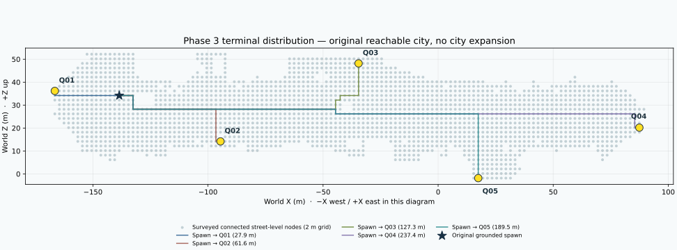

# Phase 3 — complete learning workflow, distribution and resume

## Scope and acceptance boundary

Started `feature/phase-3-learning-workflow` from verified latest `main`
**`3142bd30534519669f545e835a078c8f4739ed1f`**, the accepted Phase 2 PR #4
merge. GitHub showed no open PRs before this work. Phase 0–2 and the speed
adjustment are accepted; their historical stops are superseded by the instructor's
Phase 3 authorization. The repository was verified **Private** and its visibility
was not changed. No upstream repository or teacher editor was modified.

Implementation and available automated checks are complete. Deliver a **Draft PR**
and stop for instructor Windows 11 Chrome/Edge acceptance. Do not merge, release,
deploy, publish coursework/fixtures or begin Phase 4. Asset redistribution rights
remain unresolved; they do not prevent this authorized private feature work.

## Final terminal distribution

The original environment remains one long, limited-width connected corridor
with side spurs. The conservative standing-walk survey covers X **−166.564 to
89.436** and Z **−1.819 to 52.181**, about **256 × 54 m**. No building, road,
district, terrain or playable boundary was added or moved. The original camera
start remains `[-138.564, -3.95, 34.181]`; its normal ground snap settles the
standing eye at Y ≈ −3.85 above the unchanged ground at −5.4.

| Terminal | Fixed world base `[x, y, z]` | Placement rationale | Measured walk from spawn to approach |
| --- | --- | --- | ---: |
| Q01 | `[-166.564, -5.4, 36.181]` | Clear western end; covers the reachable area behind the original spawn | 27.9 m |
| Q02 | `[-94.564, -5.4, 14.181]` | Western −Z frontage, separate from the central walking trunk | 61.6 m |
| Q03 | `[-34.564, -5.4, 48.181]` | Central +Z frontage, on the opposite side of the corridor | 127.3 m |
| Q04 | `[87.436, -5.4, 20.181]` | Clear far +X end/bend | 237.4 m |
| Q05 | `[17.436, -5.4, -1.819]` | Eastern −Z spur, separated by its actual walking route | 189.5 m |

The first four sites retain the entire **254 m X span** when Q05 is hidden.
Exactly five readable labels and indicators remain. Unpassed indicators are
yellow; passed indicators use a shared green basic material. Label size, casing,
2.6 m interaction radius, X, original spawn and movement rules are retained.
S01–S12 all use the same sites. Four-question units hide/deactivate Q05 and
remove its casing from the collider array; five-question units restore it.



The diagram shows sampled reachable points and tested routes, not a rendered
city map or an assertion about geographic north. +Z is up; X/Z are world metres.
The original corridor forces shared walking segments. The sites cover its ends
and opposite-side frontages/spur rather than creating artificial separate districts.

| Pair | Straight-line centers (m) | Measured walking route between approaches (m) |
| --- | ---: | ---: |
| Q01–Q02 | 75.3 | 89.6 |
| Q01–Q03 | 132.5 | 155.3 |
| Q01–Q04 | 254.5 | 265.4 |
| Q01–Q05 | 187.9 | 217.4 |
| Q02–Q03 | 69.0 | 93.6 |
| Q02–Q04 | 182.1 | 187.7 |
| Q02–Q05 | 113.1 | 135.6 |
| Q03–Q04 | 125.2 | 144.6 |
| Q03–Q05 | 72.1 | 96.9 |
| Q04–Q05 | 73.4 | 87.8 |

Walking values are **measured controller travel along tested routes**, not exact
continuous shortest paths. Each endpoint is a documented stand-off/interaction
approach, about 2 m from its kiosk center. Grid resolution is 2 m, survey endpoint
tolerance 18 cm, final continuous-route tolerance 13 cm; distances are rounded
to 0.1 m. The greedy selection maximizes minimum **walking-graph** separation
over safe candidates after seeding the farthest point from spawn. Spawn is not
treated as a sixth terminal. This is an evidence-backed safe arrangement, not a
claim of a mathematically global optimum or exhaustive discovery of sub-grid nooks.

## Geometry and reachability evidence

- Decode the actual bundled city, bounds and car GLBs with original transforms,
  build the existing BVHs, and retain the original walk controller/configuration.
  Survey original city/car geometry without the old kiosks at a 2 m grid and
  30 Hz. A connected edge is admitted only after actual controller traversal.
- The corrected geometry-only fixture preserves each GLB material's `doubleSided`
  flag. The older fixture omitted that collision-relevant flag. The final survey
  and **all Phase 3 routes** were rerun with matching sidedness; source assets,
  production materials and collision algorithms were not changed.
- The final graph contains **2,143 reachable nodes, 1,891 clearance candidates,
  and 8,572 tested directed neighbour movements**. Choose safe standing street-level
  sites with support at center/four base corners, 1.1 m radial clearance at four
  heights and 2.5 m vertical clearance. Route waypoints use clearance candidates
  and exclude all kiosk centers from transit.
- Final checks additionally use BVH box intersections for a **1.4 × 1.4 m,
  2.48 m-high enclosing volume**, including rotating label clearance, with 2 cm
  bottom padding for intended floor contact. It does not intersect original
  city/bounds/car geometry. Terminal-to-terminal spacing prevents overlap.
- Continuously walk **five independent spawn routes and all ten pair routes at
  60 Hz**, with all five kiosk casings and original collisions enabled. Only each
  route's starting state is initialized; no teleport/nudge occurs between waypoints.
  Every approach is inside the unchanged interaction radius. The fixture's
  conservative car AABB is used for walk blocking at chest height; the production
  car's oriented collider and algorithm remain untouched.
- Preserve the original car regression (stops at X ≈ −131.509), all labels and
  yellow indicators. Verify nearby prompts, a temporary intervening test-only
  wall blocking interaction, rejection from 10 m above, and Q05 switching behavior.

Evidence is in `tests/fixtures/terminal-survey.json` (graph, routes, approach nodes,
source asset hashes and method) and `terminal-route-metrics.json` (measured
distances). `survey-phase-3.py` regenerates survey/selection/routes;
`plot-terminal-layout.py` generates the diagram/table. No test geometry or survey
data is imported into the production application.

## Educational resources and state

`learningResources.js` adapts the approved Engineering City Lab v1.0.0
`questionResources` / `completionFormUrl` projections at source commit
`38b1dfdd73d766ec1d01999216b24dfca2126fad`. Availability comes exclusively from
the existing validated session and passed IDs; there is no second grader or
completion tracker. The 15 original imported contract/parity artifacts, URL rules,
schemas, normalization, required explanation URL and single-answer acceptance
are unchanged. See [assignment-reuse.md](assignment-reuse.md).

- Real questions expose **Watch Question Video**, using the exact validated
  original URL. Watching is optional and is not a prerequisite for answering.
- A correct answer exposes **Watch English Explanation** and nonblank
  `explanationText`. Text uses `textContent` and `white-space: pre-wrap`; literal
  markup and line breaks remain text. Prior passes retain explanation access.
  Incorrect answers do not unlock it; one accepted v2 label is sufficient.
- At **4/4 or 5/5**, **Open Google Form** appears prominently in the HUD and the
  completed question dialog. It remains available during exploration, without a
  return-to-start requirement. The final-question tests activate it far from spawn.
- Every action is a native anchor with `target="_blank"` and
  `rel="noopener noreferrer"`. No URL rewriting, autoplay, embed, playback gate,
  viewing-time tracking, backend, submission record or student identity is added.
  Returning from a tab retains the open quiz and progress.
- Valid replacement immediately clears old question/explanation/Form hrefs and
  explanation text, resets passes/green indicators and displays the new unit.
  Failed/canceled/stale requests preserve the old valid completion and links.
  Demo Mode has no fabricated resources, even when completed. Reload resets
  selection/progress to Demo Mode; no progress storage was introduced.

## Close & Resume

The shared native-modal barrier remembers whether the **game canvas** owned
Pointer Lock immediately before quiz opening. It still releases lock, suspends
input, clears held movement, makes the background inert, blocks background events
and traps focus. An eligible quiz shows **Close & Resume**; other openings show
normal **Close**. The sticky header keeps the action reachable while reading.

A native trusted click (including button activation with Enter) closes/cleans up
the modal, resumes the existing control gate, restores focus and invokes the
existing `walkControls.requestPointerLock()` **synchronously in that same handler**.
It makes one request. The original API catches browser rejection; there is no
retry loop. Original yaw/pitch, delta rejection, ±80° limits, first-event discard,
80 ms settling, idle behavior and R/P handling are unchanged. Held W is not replayed.

Escape, programmatic/synthetic close, an originally unlocked opening and tab
focus return never request lock. Assignments retains its existing Close/Escape
flow. If a request is denied, unsupported or throttled, the existing unlocked
walk prompt clearly says **Click to resume looking around**. Another explicit
click may retry; automatic retries and browser-permission bypasses are not used.

Chromium actually throttled an unusually rapid test sequence with “Too many
pointer lock requests in a short window of time.” This is a browser restriction,
not removed by the implementation. Regression tests exercise repeated successful
mouse/keyboard resume, deliberate rejection and fallback without a retry loop.
Headless Chromium normally treats every page as focused; the dedicated focus
case disables focus emulation on a background tab and restores it on return.
This verifies browser focus/blur handling, not physical Windows OS acceptance.

## Automated results — 2026-10-28 (Asia/Taipei)

Pinned Node **22.23.4**, npm **10.9.9**; Python 3.12, Playwright 1.62.0,
`jsonschema` 4.26.0 and system Chromium on Linux.

| Check | Result |
| --- | --- |
| `npm ci` (with existing external npm cache) | Passed, 331 packages; lockfile/dependencies unchanged |
| `npm test` | **498/498 passed**: all 489 previous cases plus nine resource/distribution cases; includes all 364 validation cases, 76 answer cases, 4.5 m/s walking/9 m/s sprint and original mouse/focus regressions |
| `npm run build` | Passed; Vite 6.4.2, **201 modules**, static output generated |
| `python -m unittest tests.test_assignment_contract -v` | **5/5 passed**; exact independent Python/JS/schema errors, normalization and answer parity |
| `browser-phase-1.py` | Passed: final ground/BVH envelope/clearance checks, five spawn + ten pair routes, original car collision, labels/indicators, wall/height gates, actual Pointer Lock/relock, filters/R/P, 13 quiz cycles, input/focus isolation, retained passes and orbit/walk |
| `browser-phase-2.py` | Passed with redistributed approaches: allowlist, confirmation, cancellation/stale/error handling, v1/v2 four/five units, Q05 hide/collider removal/restore, three options, retry/member acceptance, unchanged switch location, empty-list Demo and reload/storage behavior |
| `browser-phase-3.py` | Passed: trusted mouse/Enter Close & Resume, held-key and settling/idle checks, Escape/programmatic/synthetic/unlocked safety, refusal fallback, focus return, Assignments; **8 intercepted native provider-tab actions**, exact safe URLs/opener isolation, optional resources, literal multiline explanation, revisits, v1 4/4/v2 5/5 Forms, completed-Form preservation on failed/canceled/stale loads, replacement cleanup, green indicators, Demo/reload |
| HTTPS dev/production + output audit | Passed; original document/entry resources and all **54 original public asset hashes**; production assignment directory contains only the empty manifest, with no coursework/fixtures/survey/tools/docs/schemas |
| Protected-source comparison and whitespace | Passed; no changes in core camera/controls/collision/rendering/weather/platform files, assignment contract/loader/session/selector, schemas/tools, dependency declarations or lockfile |
| Full-app WebGPU attempt | Secure context, software adapter, WebGPU backend, ENTER, HUD and five terminal objects reached; **device loss/dark canvas reproduced**. No rendered visual pass |
| New physical Windows 11 testing | **Not performed; instructor acceptance pending** |

Automated UI tests use fixture camera positions for interaction cases; continuous
walking reachability is verified separately by the controller-driven routes.
Provider destinations are intercepted before native navigation and replaced with
local synthetic HTML responses; no fixture YouTube/Form destination is contacted.
These DOM/geometry/input tests do not create a WebGPU renderer or establish FPS,
visual parity, distant label readability through fog, or Windows compatibility.

The separate full-app software-WebGPU diagnostic reproduced
`A valid external Instance reference no longer exists`,
`WebGPU Device Lost`, and `Instance dropped in popErrorScope`. The screenshot
remained dark behind working UI. No effects were disabled and no renderer/shader
was rewritten to conceal this known cloud limitation. No hardware GPU performance
or new physical acceptance is claimed. Existing large-bundle and transitive
`tar@7.5.7` deprecation warnings remain outside this feature scope.

## Changed-file inventory

| Files | Purpose |
| --- | --- |
| `src/education/learningResources.js` | Validated-session resource projection and native safe-link state/reset |
| `src/education/createQuizModal.js`, `createEducationSystem.js` | Question/explanation/Form UI, active completion HUD and gated resume callback |
| `src/education/createModalBarrier.js` | Capture original lock eligibility and execute one trusted Close & Resume request after shared cleanup |
| `src/ui/walk/createWalkPrompt.js` | Clear unlocked fallback wording; request/input logic unchanged |
| `src/education/terminalLayout.js`, `createTerminals.js`, `education.css` | Five surveyed fixed positions, shared green completion indicator, native-link/long-text/sticky-close styling |
| `tests/helpers/loadGeometry.js` | Preserve source material sidedness while omitting test texture/shader work |
| `tests/helpers/surveyCity.js`, `verifyTerminalRoutes.js` | Original-controller connected graph, safe candidates, actual continuous routes, support/envelope/wall/height checks |
| `tests/fixtures/terminal-survey.json`, `terminal-route-metrics.json` | Source-hashed test-only geometry/route evidence |
| `tests/harness.html`, `scripts/browser-phase-1.py`, `browser-phase-2.py` | New surveyed approaches and intentional Close & Resume/native-link expectations, with old protection checks retained |
| `tests/learning-resources.test.js`, `terminal-survey.test.js` | Optional/gated resources, exact URLs, stale snapshot/reset, literal text and fixed evidence-backed distribution |
| `scripts/browser-phase-3.py` | Native provider-tab and Pointer Lock resume/refusal/focus tests |
| `scripts/survey-phase-3.py`, `plot-terminal-layout.py`, `probe-webgpu.py` | Reproducible survey/diagram and optional honest full-app GPU diagnostic |
| `AGENTS.md`, `Plan.md`, `docs/phase-2-results.md` | Acceptance/merge history and current Phase 3 authorization/stop |
| `docs/assignment-integration.md`, `assignment-reuse.md`, this report, `phase-3-terminal-layout.svg` | Workflow/provenance, limitations, coordinates/distances/diagram and Windows checklist |

Core `src/bootstrap`, `controls`, `runtime`, `world`, `post`, `tsl`, `platform`,
all `public/` files, assignment validators/schemas/session/loader/selector,
teacher-side tools, package declarations and lockfile remain byte-identical to
merged main. There is one original animation loop. No new light or expensive
shader/pass was added. Only terminal positions and simple indicator materials
change the environment's educational objects.

## Reproduce

With the established pinned Node environment:

```bash
npm ci
npm test
npm run build
python -m unittest tests.test_assignment_contract -v
BROWSER=none npm run dev -- --host 127.0.0.1 --port 5173 --strictPort
```

Export that running server's **public certificate**, as in Phase 0. In a second
shell run all three `scripts/browser-phase-{1,2,3}.py --cafile <certificate>`.
To regenerate evidence, run `survey-phase-3.py --cafile <certificate> --output
<survey.json>` and review it before updating the committed test fixture/layout.
The Phase 1 browser script writes measured distances to
`/tmp/phase-3-route-distances.json`; the committed metrics feed
`python scripts/plot-terminal-layout.py` (optional Matplotlib dependency).

`python scripts/probe-webgpu.py --cafile <certificate> --software-webgpu` is an
optional separate full-app diagnostic. It writes JSON/screenshot under `/tmp`
and exits nonzero on device/startup errors; canvas/HUD presence is not a visual
pass. The local production preview check used port **4175**, as earlier preview
processes occupied 4173/4174. Restart servers after `npm ci` and export their
current certificate; do not disable TLS verification or trust stale certificates.

## Windows 11 Chrome/Edge acceptance checklist

Run on both supported physical browsers/GPU. Use instructor-controlled local
acceptance exports or intercepted fixtures, without publishing test data to a
production assignment directory. Record versions/GPU and exact failure steps.

- [ ] Original city, bounds, spawn, rain, wet reflections, lighting, smoke,
  billboards and all original effects render normally. No visual downgrade.
- [ ] Walk from original spawn to all five new sites by ordinary movement.
  Verify support/clearance, discoverability, readable labels and yellow indicators
  through real fog/post effects. No clipping or inaccessible placement.
- [ ] Q01–Q04 remain spread when Q05 is hidden. Five-question units restore Q05
  at its fixed site. X works only nearby and cannot reach through walls/above floors.
- [ ] Normal walk remains 4.5 m/s, Shift maximum 9 m/s, with the original smooth
  response, crouch, collision/ground behavior and unchanged camera mode switching.
- [ ] Rapid/slow/diagonal mouse motion, idle, R/P, lock/unlock and focus changes
  retain the severe-upward-rotation fix and do not jump or drift.
- [ ] From locked walking, X safely unlocks/suspends. Mouse Close & Resume and
  keyboard activation immediately attempt lock and retain orientation/held-key cleanup.
- [ ] Repeat quiz cycles. Denied/throttled lock leaves the clear click-to-resume
  fallback and never retries automatically. Escape closes without forcing lock.
- [ ] Open while unlocked: Close does not steal lock/focus. Assignments stays
  usable. Background Settings/About/Source/Controls/canvas cannot activate under
  either modal; Tab/Shift+Tab and Close/Escape remain safe, including long text.
- [ ] Real question video opens the exact assigned URL in a new tab only on
  explicit action. Returning retains the open quiz/progress and never auto-locks.
  Answering works without watching first; no embeds or viewing-time checks.
- [ ] Wrong answers do not unlock explanation. A v1 correct answer or any one
  accepted v2 label unlocks optional English explanation; text/line breaks and
  literal markup are safe. Completed questions retain explanation access.
- [ ] Forms remain locked before 4/4 or 5/5 and appear in HUD and completed quiz
  at the correct total. Open from a distant terminal/exploration without returning
  to spawn. Return from the Form preserves completion and does not force lock.
- [ ] Failed/canceled/stale unit requests retain completed resources; successful
  replacement clears old links/text, resets progress/indicator colors and keeps
  player location. Manifest allowlist and v1/v2 exports work unchanged.
- [ ] Passed terminals turn green independently. Demo Mode has no fabricated
  video/explanation/Form links, even at 5/5. Reload resets progress/selection;
  no local/session storage, student identity, answer logging or analytics is added.

## Remaining limits and stop

Physical Phase 3 acceptance remains pending, including rendered visibility at
the new sites and browser-specific popup/Pointer Lock policies. Cloud WebGPU
device loss prevents a rendered parity/performance claim. Geometry sampling is
conservative at 2 m; measured routes prove these sites rather than every possible
city path. Original absolute city/media paths remain a separate Apache subdirectory
release concern; assignment requests retain the tested document-relative base.

All [upstream asset licensing warnings](asset-licenses.md), including the five
GLBs' missing redistribution evidence, remain a **public release/deployment
blocker**. The repository stays Private; no coursework or fixture unit is published.
Stop after the Draft PR and wait for instructor acceptance before Phase 4.
